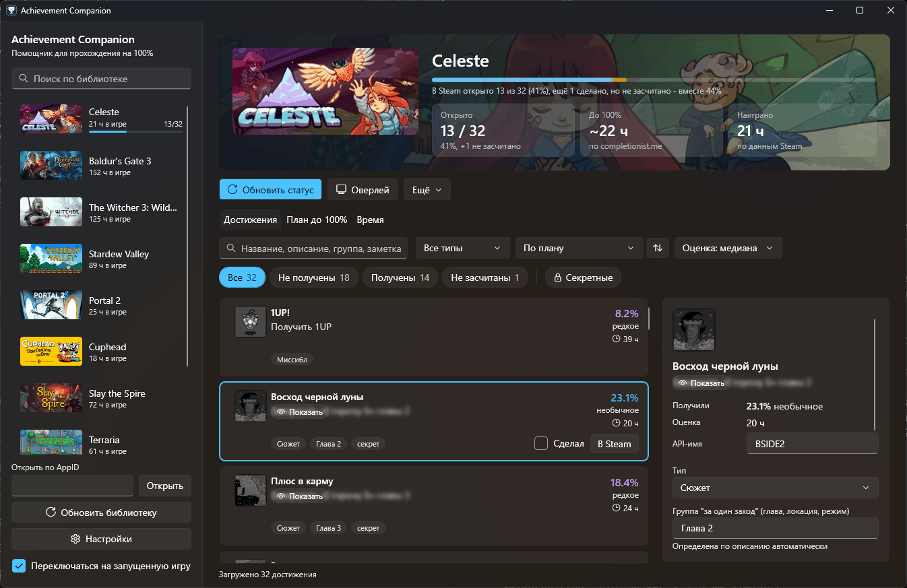
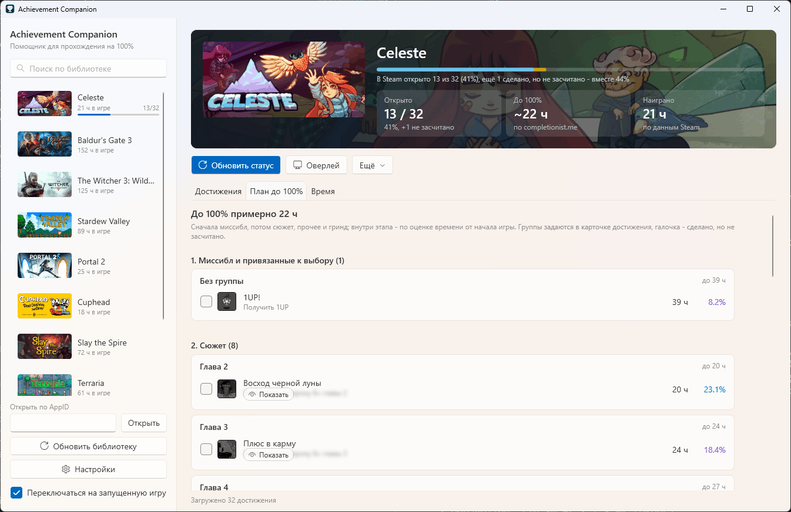
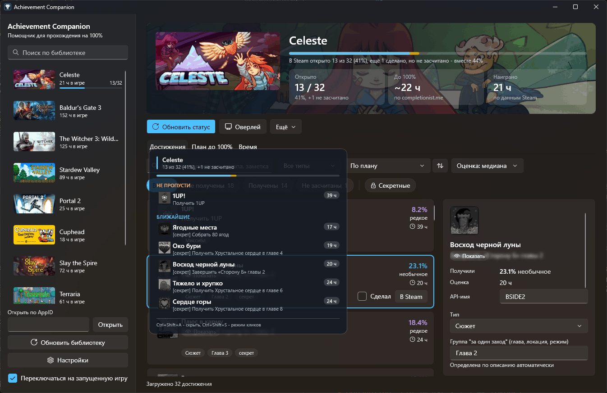

<p align="center">
  
</p>

<h1 align="center">Achievement Companion</h1>

<p align="center">
  Помощник для прохождения Steam-игр на 100% под Windows.<br />
  <a href="../../releases/latest"><b>Скачать последнюю версию</b></a>
</p>



## Возможности

- Все достижения игры: иконка, описание (у секретных размыто до клика), процент получивших, редкость, оценка времени.
- Статус подтягивается из Steam сам, в том числе пока идёт игра.
- Отметка "сделал, но не засчиталось" для достижений, которые не записались в Steam.
- Запись в Steam как в SAM: одно достижение или несколько выделенных; записанное можно снять, всё пишется в журнал.
- План до 100%: сначала миссибл, потом сюжет, прочее и гринд; группы "за один заход" (главы находятся сами); сколько осталось с учётом твоего темпа.
- Время до 100% вручную, по своей выборке игроков (авторы обзоров Steam) или по своему прогрессу. Выборка даёт и проценты, если Steam их не отдаёт.
- Оверлей поверх игры: "не пропусти" и "ближайшие", отметка в один клик. Игру не трогает: без внедрения и чтения памяти.
- Поиск гайдов по достижению (Steam, обсуждения, YouTube, Google), экспорт в CSV и JSON, файлы разметки игры.
- Светлая, тёмная или как в Windows тема.

| План до 100% | Оверлей |
| --- | --- |
|  |  |

## Установка

1. Скачай `AchievementCompanion-<версия>-win-x64.zip` со страницы [релизов](../../releases/latest).
2. Распакуй в любую папку и запусти `AchievementCompanion.exe`. Ставить .NET не нужно.

Нужны Windows 10 или 11 (x64) и Steam-клиент.

## Первый запуск

1. Настройки: "Взять из Steam" подставит SteamID64. "Получить ключ" откроет страницу Web API ключа: в поле домена впиши `localhost`, вставь ключ в настройки.
2. Нажми "Обновить библиотеку" и выбери игру слева. Запущенную игру приложение откроет само.
3. Если профиль Steam скрыт, выбери в настройках источник статуса "Steam-клиент".

Без ключа статус читается через Steam-клиент, а игру открывают по AppID: библиотеку без ключа не загрузить.

## Горячие клавиши

| Сочетание | Действие |
| --- | --- |
| `Ctrl+Shift+A` | показать или скрыть оверлей |
| `Ctrl+Shift+S` | режим кликов в оверлее: отмечать и перетаскивать |

Сочетания меняются в настройках. Оверлей виден в оконном и borderless режиме, в эксклюзивном полноэкранном - нет.

## Данные

По умолчанию `%LocalAppData%\AchievementCompanion`: файл на игру, настройки (API-ключ зашифрован DPAPI),
журнал записей в Steam `unlock_log.jsonl`, журнал ошибок `app.log`, кеш картинок.

- Портативный режим: создай папку `data` рядом с `AchievementCompanion.exe`.
- Другая папка: переменная окружения `AC_DATA_DIR`.

## Сборка

Нужен .NET 10 SDK.

```
dotnet build AchievementCompanion.sln -c Release
dotnet run --project tests/AC.Core.Tests -c Release
src\AC.App\bin\Release\net10.0-windows\AchievementCompanion.exe
```

Устройство проекта, правила кода, коммитов и релизов - в [AGENTS.md](AGENTS.md).

## Предупреждение

Запись достижений через Steam-клиент Valve официально не поддерживает. Сайты-рейтинги (Steam Hunters,
completionist.me) могут пометить профиль, если много достижений откроется в одну секунду.

## Лицензия

[MIT](LICENSE). В `src/AC.SteamBridge/SAM.API` - код [Steam Achievement Manager](https://github.com/gibbed/SteamAchievementManager) (zlib).
