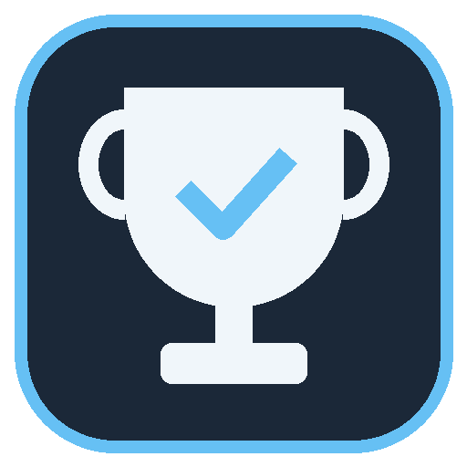

<p align="center">
  
</p>

<h1 align="center">Achievement Companion</h1>

<p align="center">
  Помощник для прохождения Steam-игр на 100%: все достижения с оценкой времени и редкостью,
  автоучёт полученного, план прохождения, оверлей поверх игры и запись в Steam как в SAM.
</p>

<p align="center">
  <a href="../../releases/latest"><b>Скачать последнюю версию</b></a>
</p>

---

## Возможности

- **Список достижений** с иконками, глобальным %, редкостью и оценкой времени. Сортировки, фильтры, поиск.
- **Автоучёт:** статус подтягивается из Steam сам, в том числе пока идёт игра.
- **"Сделал, но не засчиталось"** - ручные отметки для достижений, которые не записались (например, игра запускалась под чужим AppID).
- **Запись в Steam как в SAM:** кнопка "В Steam" у достижения или у нескольких выделенных сразу. Защищённые сервером достижения пропускаются, каждая запись попадает в журнал, записанное можно снять.
- **План до 100%:** сначала миссибл, потом сюжет, прочее и гринд; группы "за один заход"; сколько примерно осталось.
- **Оценка времени** по времени до 100% (вручную или с completionist.me), а для новых игр - по твоему прогрессу.
- **Своя статистика по игрокам:** если Steam не отдаёт глобальные проценты (так бывает у новых игр), приложение берёт авторов обзоров игры, смотрит открытые профили и считает проценты и сколько было наиграно к каждому достижению.
- **Как получить:** у каждого достижения кнопки поиска гайдов Steam, обсуждений, YouTube и Google.
- **Своё время в игре:** если много стоял в AFK или достижения добавили позже.
- **Оверлей** поверх игры: "не пропусти" и "ближайшие", отметка в один клик. Без внедрения в игру и чтения её памяти.
- **Экспорт** в CSV и JSON, файлы разметки игры (типы, группы, оценки), которыми можно делиться.
- Светлая и тёмная тема по настройкам Windows.

## Установка

1. Скачай `AchievementCompanion-<версия>-win-x64.zip` со страницы [релизов](../../releases/latest).
2. Распакуй в любую папку и запусти `AchievementCompanion.exe`. Устанавливать .NET не нужно.
3. Steam должен быть запущен.

Нужна Windows 10 или 11 (x64).

## Первый запуск

1. **Настройки:** нажми "Получить ключ", на странице Steam в поле домена впиши `localhost`, вставь ключ. SteamID64 подставится сам.
2. **Обновить библиотеку** и выбери игру слева. Если игра уже запущена, приложение переключится на неё само.
3. Если профиль Steam скрыт, выбери в настройках источник статуса "Steam-клиент".

## Горячие клавиши

| Сочетание | Действие |
| --- | --- |
| `Ctrl+Shift+A` | показать / скрыть оверлей |
| `Ctrl+Shift+S` | режим кликов в оверлее (отмечать, перетаскивать) |

Оверлей виден в оконном и borderless режиме игры, в эксклюзивном полноэкранном - нет.

## Где хранятся данные

`%LocalAppData%\AchievementCompanion\`: по файлу на игру, настройки (API-ключ зашифрован DPAPI) и журнал записей в Steam `unlock_log.jsonl`.

## Сборка из исходников

Нужен .NET 10 SDK.

```
dotnet build AchievementCompanion.sln -c Release
dotnet run --project tests/AC.Core.Tests
dotnet src\AC.App\bin\Release\net10.0-windows\AchievementCompanion.dll
```

| Проект | Что внутри |
| --- | --- |
| `src/AC.Core` | модели, статусы, классификатор типов, оценка времени, планировщик, экспорт, разбор файлов Steam |
| `src/AC.Infrastructure` | хранилище, Steam Web API, файлы и реестр Steam, запуск помощника, сценарии |
| `src/AC.SteamBridge` | помощник x86 для чтения и записи достижений через Steam-клиент (SAM.API) |
| `src/AC.App` | интерфейс WPF: главное окно, оверлей, настройки |
| `tests/AC.Core.Tests` | тесты логики и хранилища |

Релиз собирается GitHub Actions по тегу: `git tag v0.4.0 && git push origin v0.4.0`.

## Предупреждение

Запись достижений в Steam через Steam-клиент Valve официально не поддерживает. Сайты-рейтинги
(Steam Hunters, completionist.me) могут пометить профиль, если много достижений откроется в одну секунду.
Пользуйся на свой страх и риск.

## Документация

- [AGENTS.md](AGENTS.md) - устройство, источники данных, как считается время, правила и выпуск релизов.
- Что менялось - в описаниях [релизов](https://github.com/UsusCimex/AchievementCompanion/releases).

## Лицензия

MIT. В `src/AC.SteamBridge/SAM.API` - код [Steam Achievement Manager](https://github.com/gibbed/SteamAchievementManager) (zlib).
